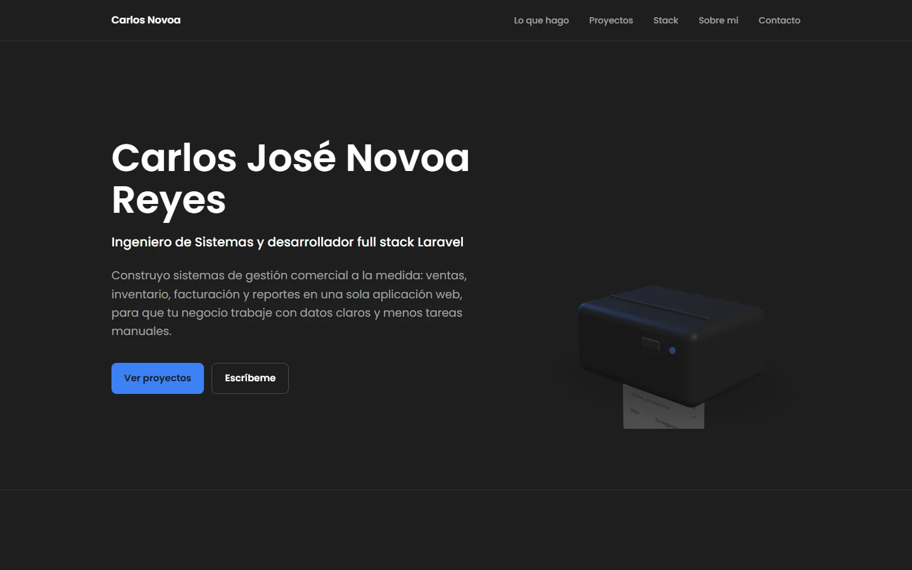
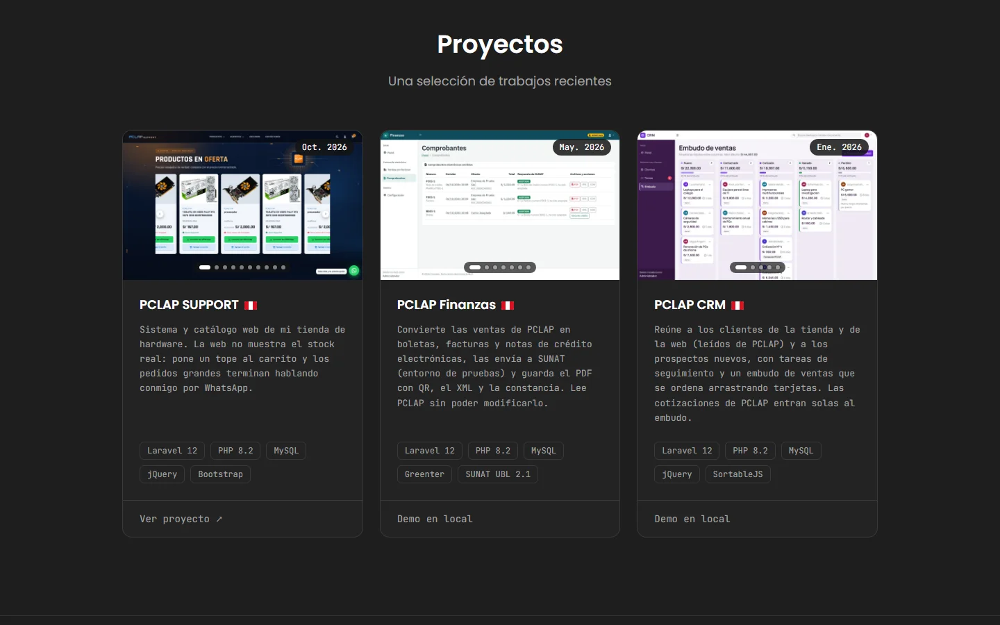

# Carlos José Novoa Reyes

**Ingeniero de Sistemas y desarrollador full stack Laravel.** Construyo sistemas de gestión comercial a la medida: ventas, inventario, facturación y reportes en una sola aplicación web, para que un negocio trabaje con datos claros y menos tareas manuales.

**[Ver el portafolio en vivo](https://lucent-kheer-7301b0.netlify.app/)**



## Sobre mí

Trabajo con Laravel de punta a punta: diseño la base de datos, construyo la lógica del negocio y entrego interfaces que el equipo puede usar sin un manual de por medio.

Me especializo en sistemas de gestión comercial porque ahí el software se nota: cada venta registrada, cada producto con el stock correcto y cada reporte a tiempo es trabajo que alguien deja de hacer a mano.

## Proyectos: un ERP en tres sistemas

Los tres giran alrededor de PCLAP SUPPORT, mi tienda de hardware en Lima.

| Sistema | Qué resuelve | Dónde verlo |
|---|---|---|
| **PCLAP SUPPORT** | Punto de venta, compras, inventario por número de serie y tienda web con pedidos por WhatsApp. | En producción: [pclap-support.com](https://www.pclap-support.com) |
| **PCLAP Finanzas** | Convierte las ventas en boletas, facturas y notas de crédito electrónicas y las envía a SUNAT (entorno de pruebas), con PDF, QR, XML firmado y CDR. | [Código en GitHub](https://github.com/NovoaaMaster/Sistema-de-Finanzas-basico) |
| **PCLAP CRM** | Clientes de la tienda y prospectos con etiquetas automáticas, tareas de seguimiento y un embudo de ventas que se ordena arrastrando tarjetas. | [Código en GitHub](https://github.com/NovoaaMaster/sistema-admin-de-recursos-humanos) |

PCLAP SUPPORT está en producción, por eso Finanzas y el CRM lo leen con un usuario de base de datos que solo puede consultar. Ningún módulo puede modificar el sistema de la tienda.



## Lo que hago

- **Sistemas de gestión comercial.** Ventas, compras, inventario, clientes y proveedores en un solo sistema, hecho a la medida de cómo opera el negocio.
- **Facturación y reportes.** Comprobantes electrónicos, cierres de caja y reportes que muestran cómo va el negocio sin armar hojas de cálculo a mano.
- **Paneles administrativos.** Usuarios, roles y permisos para que cada persona vea y haga solo lo que le corresponde.
- **Integraciones y mantenimiento.** Conecto sistemas con otros servicios mediante APIs y mantengo o modernizo aplicaciones Laravel existentes.

## Cómo está hecha esta página

- Laravel 12 y Blade, con Tailwind CSS 4 y Vite 7.
- La portada usa three.js: una impresora térmica en 3D imprime un ticket con lo que desarrollo. En equipos sin WebGL2, de gama baja o con "reducir movimiento" activado, se muestra un ticket en 2D.
- Los proyectos salen de `config/proyectos.php`. Para agregar uno se copia un bloque; las vistas no se tocan.
- Se publica en Netlify, que no ejecuta PHP. En cada push, Netlify compila los estilos y `php artisan portafolio:exportar` genera la página como HTML fijo (ver `netlify.toml`).
- Pruebas automáticas con PHPUnit.

## Ejecutarlo en local

Necesitas PHP 8.2 o superior, Composer y Node.js 20.19 o superior.

```bash
git clone https://github.com/NovoaaMaster/Portafolio.git
cd Portafolio
composer install
npm install
cp .env.example .env
php artisan key:generate
php -r "touch('database/database.sqlite');"
php artisan migrate
npm run build
php artisan serve                  # abre http://127.0.0.1:8000
```

Otros comandos:

```bash
php artisan test                   # pruebas
php artisan portafolio:exportar    # genera en dist/ la versión fija que publica Netlify
```

## Contacto

- Correo: [carlosjnovoar@gmail.com](mailto:carlosjnovoar@gmail.com)
- WhatsApp: [+51 910 318 185](https://wa.me/51910318185)
- Portafolio: [lucent-kheer-7301b0.netlify.app](https://lucent-kheer-7301b0.netlify.app/)
